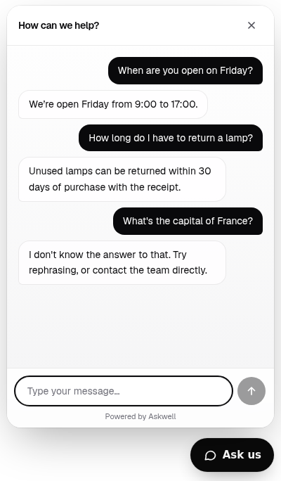
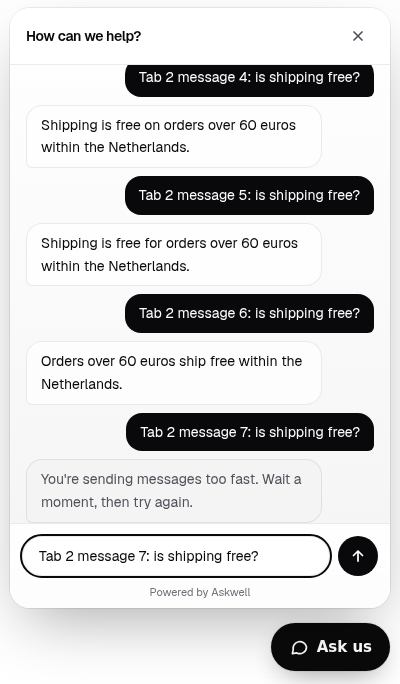
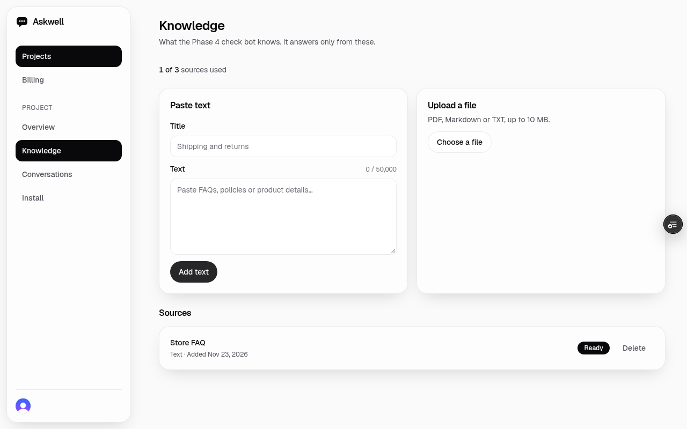
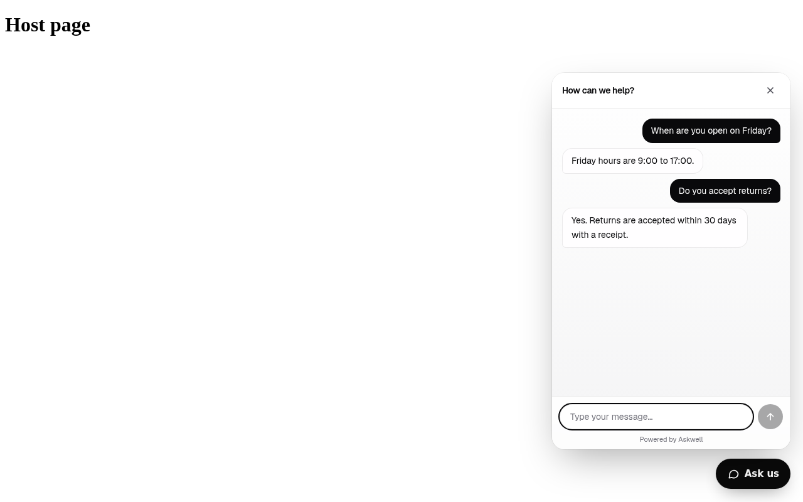
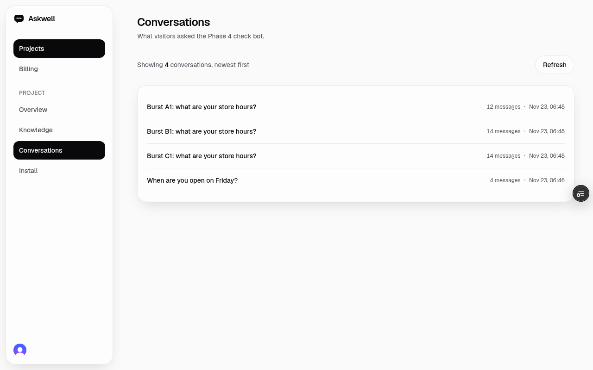
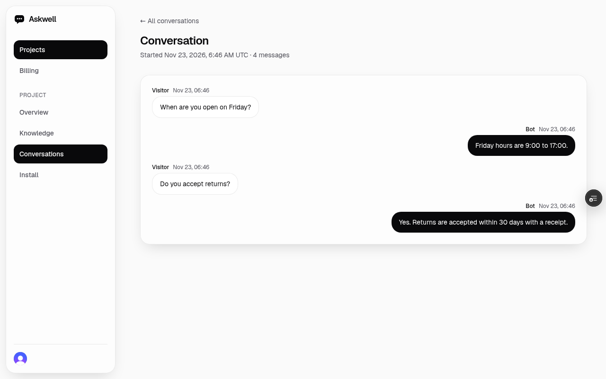
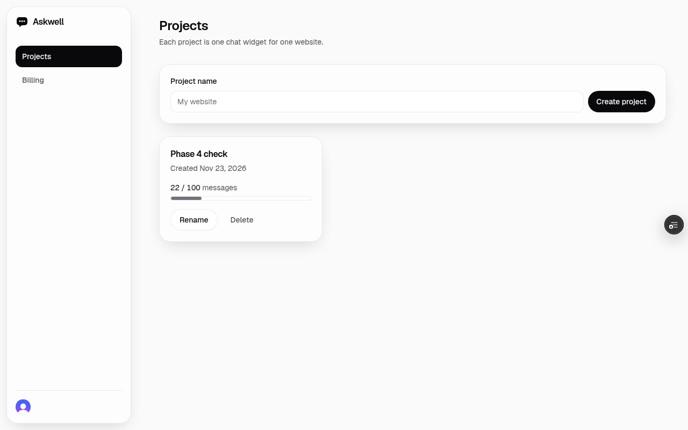
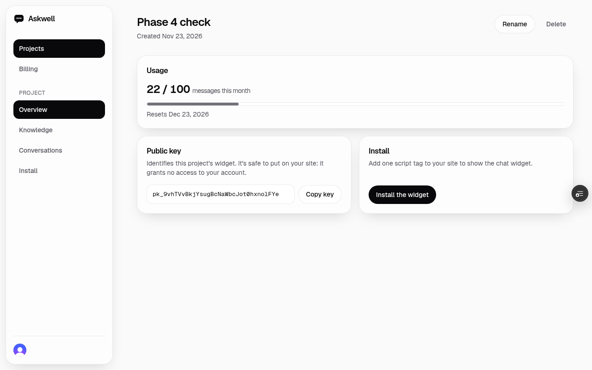
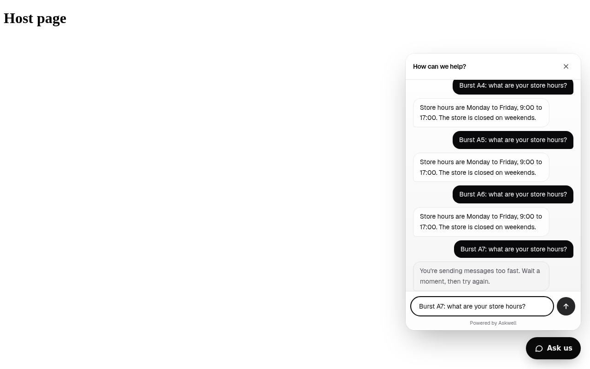

# Widget loader

`src/` is the script customers paste (`<script src="<app>/widget.js" data-key="pk_…" defer>`).
esbuild bundles it to `dist/widget.js`, and the web app's build copies it to `apps/web/public/widget.js`
(served at `<app origin>/widget.js`). See `docs/project.md` §6.5.

| Command | Does |
|---|---|
| `pnpm --filter @askwell/widget build` | Builds `dist/widget.js` (minified IIFE) |
| `pnpm --filter @askwell/widget test` | Vitest with happy-dom |
| `pnpm --filter @askwell/widget typecheck` | `tsc --noEmit` |

## Testing cross-origin against a Vercel preview

The widget only proves itself on a page from **another origin**, the way a customer's site loads it.

1. **Get a key.** Sign in on the preview, create a project, open **Install**, and copy the snippet.
   Its `src` points at the preview's **branch** URL (`appUrl()` uses `VERCEL_BRANCH_URL`), which always
   serves the branch's latest deployment. To test a specific older commit, replace the snippet's origin
   with that deployment's own URL. Either way, check the origin in `src` before testing.
2. **Serve a plain page from another origin**, containing only the snippet:
   ```bash
   mkdir -p /tmp/host && cd /tmp/host
   printf '<!doctype html><title>Host</title><h1>Host page</h1>\n%s\n' '<paste the snippet>' > index.html
   python3 -m http.server 5050   # http://localhost:5050
   ```
3. **Get past preview protection.** Previews need `x-vercel-protection-bypass: $VERCEL_AUTOMATION_BYPASS_SECRET`
   on every request to the preview. A normal browser can't add headers to a third-party `<script>` or
   `<iframe>`, so drive the browser with Playwright:
   - `context.route("<preview>/**", r => r.continue({ headers: { ...r.request().headers(), "x-vercel-protection-bypass": secret } }))`.
     It adds the header to the script, the config fetch and the `/embed` iframe.
   - Don't rely on `x-vercel-set-bypass-cookie: samesitenone` for the `/embed` iframe. Vercel answers with a
     307 that sets the cookie, but a browser that blocks third-party cookies (Chromium does) never stores it,
     so the iframe redirects in a loop (`307` → `307` → …). Also, the loader fetches its config with
     `credentials: "omit"`, so a cookie would never reach that request anyway. The header on every request
     covers the script, the config fetch and the iframe.
4. **Check:**
   - The button appears bottom right ("Ask us", black by default).
   - Click → the panel opens with the project's header and, on Free, "Powered by Askwell".
   - Send a message → typing → a reply from the chat route (see the Phase 3 check below for real answers).
   - The ✕ button, Escape inside the panel, and Escape on the host page all close it.
   - With an unknown but well-formed `data-key` (e.g. `pk_UnknownKeyUnknownKey0000`), nothing renders and the host page logs only one `[askwell]` warning.
     `/embed?key=<unknown>&origin=…` is an empty page.

## Phase 3 check: knowledge → answer → rate limit

Run it on a preview with Lanes A and B merged. Use a **fresh project** (Free has 100 messages a month,
and this check uses about 25), or reset `messages_used` on dev afterward. Delete the test project and
test user when you're done.

**Prerequisite:** the preview needs `ARCJET_KEY` (and `OPENAI_API_KEY`). Without an Arcjet key the
protection helper fails open, so the 21st message passes. If the limit never triggers, check the
deployment's logs for Arcjet errors before suspecting the rule.

1. **Make a PDF** with a few clear facts. Headless Chromium can print one from HTML:
   ```bash
   printf '<h1>Store FAQ</h1><p>Store hours: Monday to Friday, 9:00 to 17:00. Closed on weekends.</p><p>Returns are accepted within 30 days with a receipt.</p>' > /tmp/faq.html
   chromium --headless --no-sandbox --print-to-pdf=/tmp/faq.pdf /tmp/faq.html
   ```
2. **Upload it.** Sign in on the preview (a `+clerk_test` user, code `424242`) → create a project →
   **Knowledge** → upload the PDF → wait until the source shows **Ready**.
3. **Install** → copy the snippet → serve it on another origin and drive it with Playwright, as above.
4. **Record the baseline** before sending anything: on dev,
   `select messages_used from projects where public_key = 'pk_…'`.
5. **Check in the panel:**

   | Ask | Expect |
   |---|---|
   | A fact from the PDF ("When are you open on Friday?") | The correct answer from the PDF |
   | Something unrelated ("What's the capital of France?") | Exactly `NO_ANSWER_REPLY` (`apps/web/lib/ai/answer.ts`) |
   | 21 messages within one minute | The 21st shows "You're sending messages too fast…" |

   The rate limit is a fixed window of 20 messages a minute per key and IP. The questions above can
   start a window, so **wait at least 61 s after the last one** before the burst; then all 21 sends
   fall in one fresh window. One panel waits for each reply (about 2 s), so a single tab can spread
   21 sends over two windows and never hit the limit. Send from 3 tabs of the same page at once
   (7 each takes about 25 s).

   Pass if the 21 sends give **20 answers and exactly one "too fast"** refusal. Don't check which send
   was refused: with three tabs, requests can reach the limiter out of send order, and a 429 comes back
   at once while an answer takes 2–3 s, so neither send order nor arrival order is the limiter's order.
6. **Check the count.** Read `messages_used` again and compare it with the baseline. It goes up by
   every request that passed the quota count step: refused (429) messages don't count, but a request
   counted and then failing later (e.g. a 500 from embedding or the model) does. With no 500s, the
   increase equals the number of answered messages.

Screenshots from the P3K-T09 run:

| PDF ready | Answers | 21st message refused |
|---|---|---|
|  |  |  |

Notes:
- Press Escape only after the panel has hydrated (it posts `askwell:ready`). The header is
  server-rendered and shows a moment before the key listener is attached.
- Clerk's sign-up bot check (Turnstile) doesn't load in headless Chromium. Sign in with a
  `+clerk_test` user instead; the email code is always `424242`.

## Phase 4 check: conversations, usage, analytics

Run it on a preview with every Phase 4 task merged. Use a new test owner and project (this check uses
about 25 messages). It reuses the cross-origin setup above. Delete the test project and user when you're done.

**Prerequisites:** the preview needs `NEXT_PUBLIC_POSTHOG_KEY` and `NEXT_PUBLIC_POSTHOG_HOST` (plus
`ARCJET_KEY` and `OPENAI_API_KEY` from Phase 3). Session replay must be turned on in the PostHog project
(Settings → Session replay → "Record user sessions"). The code asks for replays, but PostHog only stores
them when this is on.

1. **Owner flow.** In one browser context: open `/` (the funnel's landing step), sign in as the new owner,
   create a project, paste text knowledge and wait for **Ready**, then copy the snippet on **Install**.
2. **Chat** from the snippet on a plain page on another origin (see "Testing cross-origin" above). Ask two
   questions the knowledge answers.
3. **Conversations:** open the project's **Conversations**, press **Refresh**, and open the chat. All messages
   should be there, in order.
4. **Usage:** read `messages_used` on dev before and after. Check the project card (`/dashboard`) and the
   overview's Usage panel both show the new count.
5. **Rate limit → `message_blocked`:** wait 61 s, then send 21 messages from 3 tabs at once (as in the
   Phase 3 check). Expect exactly one "too fast" refusal. The refused message isn't counted.
6. **PostHog** (HogQL in the SQL editor, or the person's Activity tab):
   - The owner's person has `signed_up`, `project_created`, `knowledge_added`, `snippet_copied` and `first_chat`,
     each once.
   - `$ai_generation` events have `$ai_trace_id` = the conversation ID, the model, tokens, and
     `$ai_total_cost_usd`. Check them in **LLM analytics → Traces**.
   - One `message_blocked` with `reason: rate_limit` (random distinct ID, no message text).
   - No event has an `/embed` URL. In the browser, the `/embed` iframe sends no `/relay` request.
   - A replay of the dashboard session exists under the owner.
7. **Funnel:** the saved insight **"Owner funnel"** (Product analytics → Insights) should show the new owner
   through every step up to `first_chat`. `upgraded` stays at 0 until Phase 5 (the Clerk webhook sends it).

### Results from the P4C-T08 run (Nov 23, 2026)

| Check | Result |
|---|---|
| Widget chat on another origin | Pass. Two correct answers from the pasted text |
| Conversations after Refresh | Pass. The chat shows (4 messages); the thread is complete, visitor and bot in order |
| Usage, +1 per accepted message | Pass. 0 → 2 after two answers → 22 after the burst (20 accepted, the refused 21st not counted). Card and overview agree with `messages_used` |
| `message_blocked` | Pass. Exactly one "too fast" in 21 sends; one `message_blocked` (`reason: rate_limit`, props `reason` and `public_key` only) |
| Owner events | Pass. `signed_up`, `project_created`, `knowledge_added`, `snippet_copied` and `first_chat` once each, all under the owner's Clerk ID and one person |
| AI traces with cost | Pass. 22 `$ai_generation` events in 4 traces, one per conversation. The first chat's trace: 2 replies, 538 input tokens, $0.00056. All 22: $0.0072 |
| `/embed` sends nothing to PostHog | Pass. No `/relay` or PostHog request from the iframe; no event with an `/embed` URL |
| Dashboard session replay | Pending. Recording is off in the PostHog project settings; the product owner is turning it on |
| "Owner funnel" insight | Pass. Saved; the test owner went through landing → `first_chat` (100% each step); `upgraded` is 0 |

#### Checks left open on #34 (PostHog setup) and #35 (chat analytics)

| PR | Check | Result |
|---|---|---|
| #34 | Landing and dashboard pageviews | Pass. `$pageview` on `/` and the dashboard pages |
| #34 | A signed-in visit is identified by the Clerk user ID | Pass. `$identify` with the Clerk ID; earlier anonymous events merged into the same person |
| #34 | Sign-out resets | **Fail, moved to P4C-T09.** After sign-out, the `/sign-in` and `/` pageviews still carry the owner's Clerk ID (same person), so `reset()` didn't run |
| #34 | Client error in Error tracking | Pass. A thrown `Error("P4C-T08 client error check")` on `/dashboard` arrived as `$exception` with an issue ID, under the owner |
| #34 | Server error in Error tracking | Not run, moved to P4C-T09. Every route answers bad input with a 4xx, so a server error needs a throwing route (on a throwaway branch's preview) |
| #34 | Dashboard session replay | See above |
| #34 | `/embed` sends nothing | Pass (see above) |
| #35 | Generation with model, tokens, latency, project ID, cost; no text | Pass. E.g. `gpt-5.4-mini`, 270 in / 17 out tokens, 1.22 s, $0.000279. No `$ai_input` / `$ai_output_choices` |
| #35 | Two replies in one conversation share one trace | Pass. The first conversation's 2 replies have the same `$ai_trace_id` (its conversation ID) |

| Knowledge ready | Widget chat | Conversations after Refresh | Thread |
|---|---|---|---|
|  |  |  |  |

| Card, after 2 | Overview, after 2 | Card, after the burst | Overview, after the burst | 21st message refused |
|---|---|---|---|---|
|  |  |  |  |  |

Notes:
- **posthog-js drops headless Chromium as a bot.** Playwright's default browser sends no events. Launch with
  `--disable-blink-features=AutomationControlled` and a normal Chrome user agent. Server events aren't affected.
- **Sign-up in a sandbox.** Clerk's sign-up CAPTCHA host can be unreachable from a sandbox. Create the owner
  with the Clerk Backend API (`POST /v1/users`, a `+clerk_test` email), then sign in on the preview.
  `signed_up` still fires: it's sent when the account row is created on the first dashboard load.
- The round button at the right edge of the dashboard screenshots is Vercel's preview toolbar, not the app.
