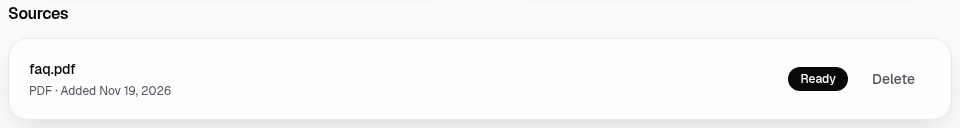

# Widget loader

`src/` is the script customers paste (`<script src="<app>/widget.js" data-key="pk_…" defer>`).
esbuild bundles it to `dist/widget.js`, and the web app's build copies it to `apps/web/public/widget.js`
(served at `<app origin>/widget.js`). See `docs/project.md` §6.5.

| Command | Does |
|---|---|
| `pnpm --filter @askwell/widget build` | Builds `dist/widget.js` (minified IIFE) |
| `pnpm --filter @askwell/widget test` | Vitest with happy-dom |
| `pnpm --filter @askwell/widget typecheck` | `tsc --noEmit` |

## Testing cross-origin against a Vercel preview

The widget only proves itself on a page from **another origin**, the way a customer's site loads it.

1. **Get a key.** Sign in on the preview, create a project, open **Install**, and copy the snippet.
   Its `src` points at the preview's **branch** URL (`appUrl()` uses `VERCEL_BRANCH_URL`), which always
   serves the branch's latest deployment. To test a specific older commit, replace the snippet's origin
   with that deployment's own URL. Either way, check the origin in `src` before testing.
2. **Serve a plain page from another origin**, containing only the snippet:
   ```bash
   mkdir -p /tmp/host && cd /tmp/host
   printf '<!doctype html><title>Host</title><h1>Host page</h1>\n%s\n' '<paste the snippet>' > index.html
   python3 -m http.server 5050   # http://localhost:5050
   ```
3. **Get past preview protection.** Previews need `x-vercel-protection-bypass: $VERCEL_AUTOMATION_BYPASS_SECRET`
   on every request to the preview. A normal browser can't add headers to a third-party `<script>` or
   `<iframe>`, so drive the browser with Playwright:
   - `context.route("<preview>/**", r => r.continue({ headers: { ...r.request().headers(), "x-vercel-protection-bypass": secret } }))`.
     It adds the header to the script, the config fetch and the `/embed` iframe.
   - Don't rely on `x-vercel-set-bypass-cookie: samesitenone` for the `/embed` iframe. Vercel answers with a
     307 that sets the cookie, but a browser that blocks third-party cookies (Chromium does) never stores it,
     so the iframe redirects in a loop (`307` → `307` → …). Also, the loader fetches its config with
     `credentials: "omit"`, so a cookie would never reach that request anyway. The header on every request
     covers the script, the config fetch and the iframe.
4. **Check:**
   - The button appears bottom right ("Ask us", black by default).
   - Click → the panel opens with the project's header and, on Free, "Powered by Askwell".
   - Send a message → typing → a reply from the chat route (see the Phase 3 check below for real answers).
   - The ✕ button, Escape inside the panel, and Escape on the host page all close it.
   - With an unknown but well-formed `data-key` (e.g. `pk_UnknownKeyUnknownKey0000`), nothing renders and the host page logs only one `[askwell]` warning.
     `/embed?key=<unknown>&origin=…` is an empty page.

## Phase 3 check: knowledge → answer → rate limit

Run it on a preview with Lanes A and B merged. Use a **fresh project** (Free has 100 messages a month,
and this check uses about 25), or reset `messages_used` on dev afterward. Delete the test project and
test user when you're done.

**Prerequisite:** the preview needs `ARCJET_KEY` (and `OPENAI_API_KEY`). Without an Arcjet key the
protection helper fails open, so the 21st message passes. If the limit never triggers, check the
deployment's logs for Arcjet errors before suspecting the rule.

1. **Make a PDF** with a few clear facts. Headless Chromium can print one from HTML:
   ```bash
   printf '<h1>Store FAQ</h1><p>Store hours: Monday to Friday, 9:00 to 17:00. Closed on weekends.</p><p>Returns are accepted within 30 days with a receipt.</p>' > /tmp/faq.html
   chromium --headless --no-sandbox --print-to-pdf=/tmp/faq.pdf /tmp/faq.html
   ```
2. **Upload it.** Sign in on the preview (a `+clerk_test` user, code `424242`) → create a project →
   **Knowledge** → upload the PDF → wait until the source shows **Ready**.
3. **Install** → copy the snippet → serve it on another origin and drive it with Playwright, as above.
4. **Record the baseline** before sending anything: on dev,
   `select messages_used from projects where public_key = 'pk_…'`.
5. **Check in the panel:**

   | Ask | Expect |
   |---|---|
   | A fact from the PDF ("When are you open on Friday?") | The correct answer from the PDF |
   | Something unrelated ("What's the capital of France?") | Exactly `NO_ANSWER_REPLY` (`apps/web/lib/ai/answer.ts`) |
   | 21 messages within one minute | The 21st shows "You're sending messages too fast…" |

   The rate limit is a fixed window of 20 messages a minute per key and IP. The questions above can
   start a window, so **wait at least 61 s after the last one** before the burst; then all 21 sends
   fall in one fresh window. One panel waits for each reply (about 2 s), so a single tab can spread
   21 sends over two windows and never hit the limit. Send from 3 tabs of the same page at once
   (7 each takes about 25 s).

   Order the results by **send** time. A 429 comes back at once while an answer takes 2–3 s, so by
   arrival time the refusal can show up before the last answers.
6. **Check the count.** Read `messages_used` again and compare it with the baseline. It goes up by
   every request that passed the quota count step: refused (429) messages don't count, but a request
   counted and then failing later (e.g. a 500 from embedding or the model) does. With no 500s, the
   increase equals the number of answered messages.

Screenshots from the P3K-T09 run:

| PDF ready | Answers | 21st message refused |
|---|---|---|
|  |  |  |

Notes:
- Press Escape only after the panel has hydrated (it posts `askwell:ready`). The header is
  server-rendered and shows a moment before the key listener is attached.
- Clerk's sign-up bot check (Turnstile) doesn't load in headless Chromium. Sign in with a
  `+clerk_test` user instead; the email code is always `424242`.
